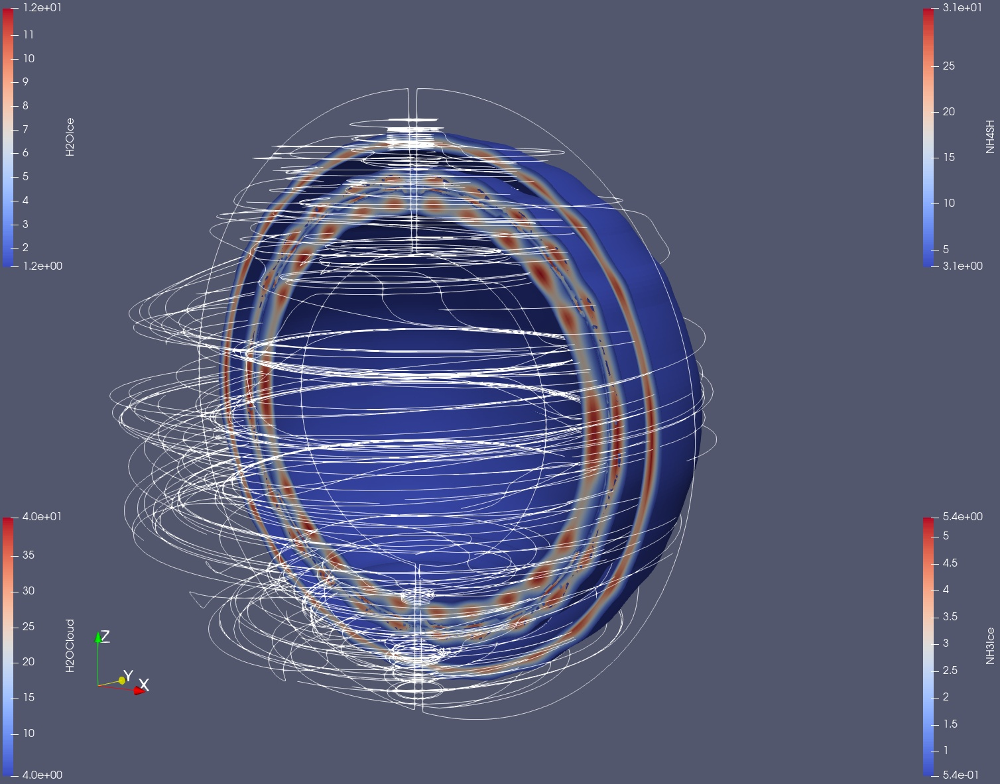
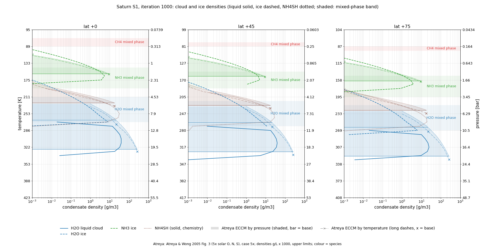

# ATSAT

A 3-D circulation model of **Saturn's** atmosphere with moist convection, clouds, chemistry and turbulence -- one of four sibling models of the giant planets.

<p align="center"></p>

<p align="center"><sub>Cloud decks (coloured by density, cut open along a meridian) and wind stream lines (white) after the spin-up; more pictures and the comparison with observed cloud profiles under <i>Cloud profiles vs Atreya</i> below.</sub></p>

**The giant-planet family.** The four models share one numerical core (finite differences on a 41 × 181 × 361 spherical grid, 4th-order Runge-Kutta, a Poisson pressure solver, OpenMP) and 14 byte-identical shared headers (saturation adjustment, precipitation, moist convection, turbulence, radiation, boundary conditions, pressure solver, observed jets, cp(T) and more); each adds its own planet's set-up, chemistry and boundaries. A fix made in one is ported to the others.

| Planet | Model | Atmospheric shell | Cloud decks | What it looks at |
|---|---|---|---|---|
| Jupiter | [ATJUP](https://github.com/RogerGrundmann/ATJUP) | 140 km, ~13 bar to ~0.03 bar | H₂O, NH₄SH, NH₃ | the Great Red Spot: a wake behind a fixed obstacle, or a free vortex |
| Saturn | **ATSAT** (this repo) | 500 km, ~55 bar to 0.04-0.07 bar | H₂O, NH₄SH, NH₃ | moist convection and the super-rotating equatorial jet; chromophore tracer |
| Uranus | [ATURAN](https://github.com/RogerGrundmann/ATURAN) | 225 km, ~17 bar to 0.10-0.14 bar | CH₄, H₂S, NH₄SH, H₂O | the 98° tilt and the equator-to-pole temperature puzzle |
| Neptune | [ATNEPT](https://github.com/RogerGrundmann/ATNEPT) | 200 km, ~32 bar to 0.03-0.05 bar | CH₄, H₂S, NH₄SH, H₂O | the fastest winds in the Solar System, driven by internal heat |

**Sister family:** the same ATOM numerics run the early Earth -- [ATHAD](https://github.com/RogerGrundmann/ATHAD) (steam atmosphere over the magma ocean) → [ATHAD_COND](https://github.com/RogerGrundmann/ATHAD_COND) (CO₂ over a hot sea) → [ATHAD_PERID](https://github.com/RogerGrundmann/ATHAD_PERID) (CO₂ after a peridotitic magma ocean).

Saturn atmospheric general circulation model based on the numerical framework of the [ATOM
climate model](https://github.com/atom-model/ATOM). Solves the 3-D Navier-Stokes equations in a spherical shell extending from
below the water-cloud base (~55 bar at the bottom; the H₂O deck forms near 20 bar) up to the
upper troposphere (~0.04-0.07 bar at the lid, below the stratospheric hydrocarbon hazes),
including full cloud microphysics and chemistry for the H₂/He atmosphere of Saturn. Its precipitation scheme -- the COSMO three-category rain / snow / graupel scheme in the shared `Precipitation.h` -- comes from [ATOM_Precipitation](https://github.com/RogerGrundmann/ATOM_Precipitation), a development version of ATOM.

Saturn presents two phenomena that motivated this work. The first is the persistent
hexagonal polar vortex observed in Saturn's northern hemisphere by Voyager and Cassini —
a six-sided standing wave pattern surrounding the pole that has remained stable for
decades. The second is Saturn's super-rotating equatorial jet, which reaches wind speeds
near 470 m/s at the cloud tops, far exceeding anything observed on Jupiter. Both features
suggest deep-seated dynamical structures that a 3-D circulation model can illuminate.

For all relevant data concerning Saturn and its atmosphere the book *Planetary Sciences*
by Imke de Pater and Jack J. Lissauer was indispensable.

**Where this model sits in the literature.** Roughly half a dozen 3-D GCMs have been run on
Saturn, of which DYNAMICO-Saturn (Spiga, Guerlet, Cabanes *et al.*, Icarus Parts I–V) is the
only sustained Saturn-dedicated programme. Those papers state that the model **does not
parametrise moist convection**, and note that it "occurs in giant planets' atmospheres and
carries substantial energy into the jet system". That is the gap ATSAT is built for: a
three-category microphysics scheme for H₂O, NH₃ and CH₄ plus NH₄SH sedimentation, coupled
into the temperature and moisture equations. The moist physics is the reason for the code,
not the dynamical core.

---

## Physics & Numerics

- **Domain:** spherical shell, 41 × 181 × 361 grid points (r × θ × φ), ~2.7 million cells
- **Vertical extent:** 500 km atmospheric shell (12.5 km per radial level)
- **Dynamics:** finite-difference discretisation of the 3-D Navier-Stokes equations in spherical coordinates
- **Time integration:** 4th-order Runge-Kutta (inner loop) with a Poisson pressure solver (outer loop)
- **Parallelism:** OpenMP shared-memory threading across the chemistry, diffusion, and saturation-adjustment hot paths
- **Thermodynamics:**
  - Temperature initialised as a parabolic pole-to-pole profile (zonally uniform); reference temperature 134 K
  - Boussinesq buoyancy, carried as an **anomaly** (horizontal mean removed at each level)
  - Clausius-Clapeyron / Sanchez-Lavega SVP formulation for saturation vapour pressures
  - Mixed-phase (liquid + ice) saturation adjustment with iterative convergence
- **Microphysics:** COSMO-derived **three-category** scheme (rain / snow / graupel) run per
  condensable species, plus Stokes sedimentation for NH₄SH crystals
- **Boundary conditions:** measured zonal wind profiles from QuikSCAT and OSCAR datasets;
  temperature/pressure profiles from Voyager (1980/81), Cassini (2004–2017), and Hubble observations
- **Planetary constants:** g = 10.0 m/s², Ω = 1.63 × 10⁻⁴ rad/s, lapse rate 0.7 K/km

### Body forces

The Coriolis, centrifugal and buoyancy terms each need a different factor to reach the
non-dimensional unit system the RHS works in (`ATSAT_NONDIM` switches all three on together;
the individual `ATSAT_ND_*` switches exist for attribution, not for production runs). All three
read the **true** sine of colatitude, reconstructed from the cosine, never the metric's polar
floor — a floor is a property of the difference scheme and has no business in a body force.

---

## Chemical Species

| Species | Phases modelled | Precipitates as |
|---------|-----------------|-----------------|
| H₂O | vapour · cloud · ice | rain · snow · graupel |
| NH₃ | vapour · cloud · ice | rain · snow · graupel |
| CH₄ | vapour · cloud · ice | rain · snow · graupel |
| H₂S | vapour | — (consumed by the NH₄SH reaction) |
| NH₄SH | solid | Stokes sedimentation |

Methane condensation, absent from the warmer Jovian troposphere, becomes a first-order
process at Saturn's lower temperatures: the model reaches 61 K at the top of the shell,
well below methane's 90.69 K triple point, and produces a genuine CH₄ ice deck and methane
precipitation reaching the ground.

### Cloud profiles vs Atreya



Saturn, arm S1 (the defaults of 2026-11-24 incl. `ATSAT_CP_H2` 1, `satchk/cph2_2026-11-24`) at iteration 1000, against Atreya & Wong 2005 Fig. 3 (5x solar): NH3 ice base ~2.3 bar (Atreya ~1.7), H2O liquid base ~21 bar (20.4), NH4SH on Atreya's curve. Condensate densities against temperature (left axis) and pressure (right axis) at three latitudes; liquid solid, ice dashed, NH4SH dotted; Atreya's ECCM shaded by pressure (bar = base) and as long dashes by temperature (x = base). Made with `python3 -I tools/cloudprofile_pv.py <zonal.vtk> --out <file.png>` (`--atreya <case>|none`, `--lat 0,45,75`); the set for all four giants is in `literature/cloudprofile_compare/` (outside the repo).


Saturn, arm S1 (the defaults of 2026-11-24, `satchk/cph2_2026-11-24`) at iteration 1000: H2O ice / cloud, NH3 ice and NH4SH on the sphere (`<Planet>_sphere_<n>.vts`, shells exaggerated to 1..2 radii), each species as the region above 10 % of its maximum, cut along the 90 / 270 deg meridians, one colour bar per species; white: Velocity stream lines. Made with `python3 -I literature/sphere_screens.py <sphere.vts> <Planet>` (outside the repo).

---

## Modules

Ported from ATJUP, the sister Jupiter model, which shares this numerical framework. Each module is gated by an `ATSAT_*` environment knob, so switching one on is a measurable change rather than a new baseline: precipitation microphysics and the shared saturation adjustment, grey radiation, the turbulence closure, the pressure solve, dry and moist (Ledoux) convective adjustment, local density, fitted vapour pressures, the thermal-wind diagnostic and the chromophore tracer, plus the numerical safety nets (NaN census, smoothing, jet set-up, damping).

The full knob tables (every environment variable with its default and effect, and the notes on them) are in [CLAUDE.md](CLAUDE.md).

---

## Diagnostics

What the model prints at the `checkpoint` cadence (min / max census, column profiles, budgets) and the print-only instruments that can be switched on.

The full text is in [CLAUDE.md](CLAUDE.md).

---

## Repository Layout

```
ATSAT/
├── planet/          # core model (RHS, RK4, thermodynamics, chemistry, microphysics, I/O)
├── lib/             # array types, config parser, FFT, utilities
├── cli/             # command-line driver (sat)
├── python/          # Cython bindings (pyatsat)
├── saturn/          # run directory (XML config, observational data, output)
│   ├── oscar/       # OSCAR ocean-current dataset (used as zonal-wind template)
│   └── windspeed/   # QuikSCAT surface wind data
├── tinyxml2/        # vendored XML library
├── param.py         # code-generation script (auto-generates parameter files)
└── Makefile
```

`param.py` is the single source of truth for every configuration parameter: it generates
`SaturnParams.h.inc`, `SaturnLoadConfig.cpp.inc`, `cSaturnDefaults.cpp.inc`, the three
`config_atsat.xml` copies and the Cython accessors. **A parameter added to the C++ but not to
`param.py` is silently dropped the next time anything regenerates.**

---

## Build

**Dependencies:** C++11 compiler with OpenMP support, Python 3, Cython, NumPy.

```bash
make            # parameter files + CLI + Python extension
make sat        # CLI binary only
make python     # Python extension only
make clean
```

### Shared physics headers

Thirteen headers in `planet/` are **byte-identical across ATJUP, ATSAT, ATNEPT and ATURAN**:

```
ATPhys.h  BoundaryConditions.h  ConvectiveAdjustment.h  FluxLimiter.h  JetRef.h  ParaViewWriter.h
Precipitation.h  PressureSolver.h  ProcessDiag.h  Radiation.h  Reporting.h  SaturationAdjustment.h  Turbulence.h
```

There is no submodule and no symlink holding them together — Synology Drive has silently reverted
a working tree once, and a submodule costs friction on every clone. They are plain copies, and
`planet/SHARED.md5` is what makes a divergence loud:

```bash
make check-shared
```

Editing one means: edit it in one repo, copy it to the other three, regenerate its line in **all
four** manifests, and rebuild each.

**`make check-shared` cannot catch everything, and this is the part to read before trusting it.**
It verifies a repo against *its own* manifest, so two repos holding different copies of the same
header both report OK — a state that has already occurred once. The check that does catch it is a
diff between repos, which is why the checksum lines are kept sorted by filename:

```bash
diff ../ATJUP/planet/SHARED.md5 planet/SHARED.md5
```

---

## Usage

### Command-line — note the TWO arguments

```bash
./cli/sat <path> <config file name>
./cli/sat . config_atsat.xml            # config in the current directory
```

A single combined path fails with `couldn't load config file inside cSaturnModel`. This is the
reverse of ATOM's `cli/atm`.

```bash
OMP_NUM_THREADS=12 ./cli/sat . config_atsat.xml > run.log 2>&1
```

### Python

```python
import sys
sys.path.insert(0, "saturn")
import pyatsat

model = pyatsat.SaturnModel()
model.load_config("saturn/config_atsat.xml")
model.run()
```

---

## Output

With `checkpoint = 100` a run writes all three output kinds on the same iterations (100, 200, …)
into `<output_path>-Saturn/`:

| file | what |
|---|---|
| `Saturn_radial_20_<n>.vtk` | one radial level, all fields, plus the 2-D surface maps |
| `Saturn_zonal_180_<n>.vtk` | meridional slice at k = 180 |
| `Saturn_longal_112_<n>.vtk` | longitudinal slice at j = 112 |
| `Saturn_panorama_<n>.vts` | the full 3-D volume (~900 MB), needs `paraview_flag`; written with the sphere every 100 iterations on which writeData runs and at `panorama_print`, or with `ATSAT_PANORAMA_STRIDE=<n>` (since 2026-10-31, as ATJUP's) every n instead. With `ATSAT_CHROM` it carries `Chromophore_mgm3` and `ChromUV`, as the slices do. Since 2026-10-31 the panorama and sphere headers name exactly the arrays written, and `P_nh3_graupel` / `P_ch4_graupel` are no longer written (zero in every Saturn output, 16 and 1000 it) |
| `Saturn_cloudview_<n>.vtk` | the view from above (since 2026-10-30, ported from ATJUP): per layer the column above it of NH3 ice and NH4SH (g/m2; + chromophore mg/m2 with `ATSAT_CHROM`), layer 0 = whole column; since 2026-11-03 drawn as concentric spherical shells, layer 0 outermost, pole rows left out (`ATSAT_CLOUDVIEW_SPHERE=0` = the old flat stack with layer 0 on the top face, `ATSAT_CLOUDVIEW_SHELL` = shell-stack thickness, default 0.05 radius), and `PhotoRGB` (a colour recipe, per-file scale). Written with every panorama by default; `ATSAT_CLOUDVIEW_STRIDE=<n>` every n iterations, 0 = never |
| `sat_restart_<n>.bin` | binary restart, 38 prognostic + 35 carried arrays (~1.5 GB, magic `"SAT3"`; + chrom / chromn with `ATSAT_CHROM`) |

Restart is controlled by `checkpoint_save_iter` (explicit dump) and `restart_from_iter`
(resume), both default −1. The periodic dump is written **only when the state is finite**, so a
diverged run can never overwrite a good restart point. The file magic is `"SAT1"`: ATJUP
restarts have identical grid dimensions and would otherwise be read as nonsense.

Since 2026-10-31 (`"SAT2"`) a resumed run reproduces the straight run byte for byte, at an even or
odd resume iteration and with `ATSAT_CHROM` (checked on the whole 3D state, not only the slices): the file also carries the 34 derived arrays the next
iteration reads before it rewrites them (`restart_arrays_carried()` in planet/FileIO_Sat.cpp: the
fluxes and sinks of the even-iteration physics block, the turbulence sources, the projection's
rhs_u / rhs_v, the seam corners of six output fields). Before, a restart differed from the straight
run (NH4SH in every cell, T up to 0.16 K at 8 -> 16). A `"SAT1"` file still loads, with the old
behaviour and a warning; `ATSAT_RESTART_CARRIED=0` writes `"SAT1"` (the old bytes).

Since 2026-11-16 (`"SAT3"`, row SAT-RESTART-NH4SH) the carried list also holds `S_precip_ch4`, the
CH4 vapour precipitation sink that rhs_ch4 reads on the odd iteration. SAT2 missed it because the
sink is zero early in a run: 8 -> 16 was exact, but a resume from 1500 of a developed run diverged
in its first step (ch4 first, then T / NH3 through the moist convective adjustment). A `"SAT2"`
file still loads, with `S_precip_ch4` at its set-up value and a warning.

---

## Known limitations

None of these stops a run; all of them affect what a result means: the thermal-massflux default, microphysics not calibrated to Saturn, the shared saturation adjustment, the borrowed CH4 `t_00`, the tiny timestep of the runs before 2026-10-09, NH3-ice clipping, and what is not mirrored from ATJUP (items 0-6).

The full text is in [CLAUDE.md](CLAUDE.md).

---

## Author

Roger Grundmann — roger.grundmann@web.de
